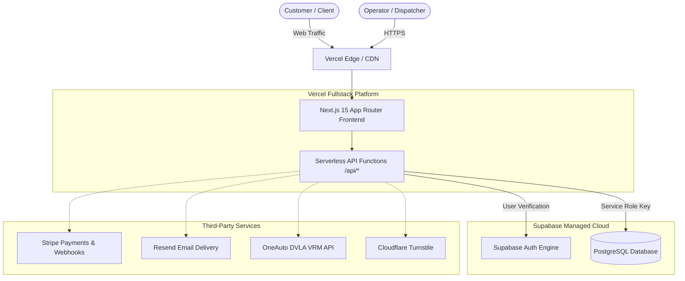

# G Force Tyres — Production Operations & Deployment Guide

This document contains the complete production architecture, deployment configuration, environment variables, administrative runbooks, and maintenance procedures for the **G Force Tyres Mobile** application.

---

## 1. System Architecture



- **Frontend & Serverless Backend**: Next.js 15 (React 19, TypeScript, Tailwind CSS) deployed on **Vercel**.
- **Database & Authentication**: Supabase PostgreSQL with Row Level Security (RLS) and Supabase Auth.
- **Resilience Engine**: Built-in fallback prevents crashes if database credentials or third-party APIs experience temporary network latency.

---

## 2. Production Environment Variables

Configure these variables in your **Vercel Project Settings → Environment Variables**:

| Variable Name | Scope | Required? | Description / Value Format |
|---|---|:---:|---|
| `NEXT_PUBLIC_SUPABASE_URL` | Public (Client + Server) | **Yes** | Supabase Project URL (`https://xyz.supabase.co`) |
| `NEXT_PUBLIC_SUPABASE_ANON_KEY` | Public (Client + Server) | **Yes** | Supabase public anonymous API key |
| `SUPABASE_SERVICE_ROLE_KEY` | Server-Only | **Yes** | Supabase privileged service role secret key |
| `APP_ENV` | Server-Only | **Yes** | Set to `production` |
| `ENABLE_MOCK_DATA` | Server-Only | **Yes** | Set to `false` (forces live database mode) |
| `APP_URL` | Server-Only | **Yes** | Canonical live site URL (e.g. `https://gforce-tyres.co.uk`) |
| `NEXT_PUBLIC_SITE_URL` | Public | **Yes** | Public site URL (same as `APP_URL`) |
| `VRM_CACHE_ENCRYPTION_KEY` | Server-Only | **Yes** | Minimum 32-character random string for caching VRMs |
| `NEXT_PUBLIC_STRIPE_PUBLISHABLE_KEY` | Public | Optional | Stripe publishable key (`pk_live_...` or `pk_test_...`) |
| `STRIPE_SECRET_KEY` | Server-Only | Optional | Stripe secret key (`sk_live_...` or `sk_test_...`) |
| `STRIPE_WEBHOOK_SECRET` | Server-Only | Optional | Stripe webhook signing secret (`whsec_...`) |
| `RESEND_API_KEY` | Server-Only | Optional | Resend email API key (`re_...`) |
| `EMAIL_FROM` | Server-Only | Optional | Sender address (e.g. `"G Force Tyres <bookings@yourdomain.co.uk>"`) |
| `ONEAUTO_API_KEY` | Server-Only | Optional | Vehicle DVLA registration lookup API key |
| `ONEAUTO_BASE_URL` | Server-Only | Optional | DVLA provider API endpoint (`https://api.oneautoapi.com`) |
| `NEXT_PUBLIC_TURNSTILE_SITE_KEY` | Public | Optional | Cloudflare Turnstile bot verification site key |
| `TURNSTILE_SECRET_KEY` | Server-Only | Optional | Cloudflare Turnstile secret key |

---

## 3. Database Management & Schema

The database schema is defined in [`supabase/schema.sql`](file:///Users/mehidehasan/Start-up/G-force-Tyres-mobile/supabase/schema.sql).

### Core Tables:
1. **`tyre_inventory`**: Tyre catalogue with dimensions (`width`, `profile`, `rim`), EU tyre ratings, tier, sell price, cost price, and active stock.
2. **`booking_slots`**: Van fitting capacity by date and time window (`08:00-10:00`, `10:30-12:30`, `13:00-15:00`, `15:30-17:30`).
3. **`slot_holds`**: 15-minute reservation tokens preventing double bookings while a customer enters checkout details.
4. **`customers`**: Customer contact and billing profiles.
5. **`bookings`**: Master booking records with status, assigned fitter, payment references, and timestamps.
6. **`booking_items`**: Line items linked to bookings with quantity and snapshot pricing.
7. **`fitters`**: Active mobile technician profiles and contact numbers.
8. **`service_zones`**: Postcode prefixes with specific callout charges (e.g. `E14` £0, `BR1` £15).
9. **`app_settings`**: Global deposit rate, fitting charges, job duration, and cancellation policies.
10. **`admin_profiles`**: Authenticated staff authorized to access dispatch and inventory management.

### Database Utility Scripts:

- **Seed or Reseed Production Catalogue & Slots**:
  ```bash
  node scripts/seed-supabase.mjs
  ```
  *Inserts 15 initial tyre products, 13 London service zones, 3 mobile fitters, and 56 booking slots for the upcoming 14 days.*

- **Provision New Admin Operators**:
  ```bash
  node scripts/create-admin.mjs <operator_email> <password> "<Full Name>"
  ```
  *Example:*
  ```bash
  node scripts/create-admin.mjs dispatch@gforcetyres.co.uk SecurePass2026! "Head Dispatcher"
  ```

---

## 4. Admin Portal Operations

- **URL**: `/admin/login`
- **Initial Operator Email**: `gforcetyres506@gmail.com`

### Admin Capabilities:

1. **Live Bookings Dispatch (`/admin/bookings`)**:
   - Filter jobs by status (`Confirmed`, `Tyres Reserved`, `Fitter Assigned`, `En Route`, `Completed`, `Cancelled`).
   - Assign mobile technicians (Dave Mitchell, Sam Okafor, Marcus Vance).
   - Log internal technician notes and customer communications.
   - Enter manual assisted bookings taken over the phone.

2. **Tyre Inventory Control (`/admin/inventory`)**:
   - Instantly update tyre stock and pricing.
   - Toggle tyres active or inactive.
   - Add new tyre specifications to the catalogue.

3. **Fitting Slot Capacity (`/admin/slots`)**:
   - Adjust capacity per window (e.g., increase from 2 to 4 vans during peak hours).
   - Generate future slot schedules in bulk.

---

## 5. Customer Self-Service Portal (`/manage/[token]`)

Every booking automatically generates a unique secure token (UUID). Customers receive this link to:
- Review their fitting appointment date and 2-hour arrival window.
- View vehicle details and tyres ordered.
- Monitor technician dispatch progress in real time.
- Cancel their booking in compliance with the business cancellation policy.

---

## 6. Continuous Deployment & Verification Runbook

### Deploying Updates:
1. Make and test changes locally:
   ```bash
   npm run typecheck
   npm run test:security
   npm run build
   ```
2. Commit and push to GitHub:
   ```bash
   git add .
   git commit -m "feat: description of changes"
   git push origin main
   ```
3. **Vercel** automatically picks up the commit on `main`, runs the production build, and deploys it to the live domain with zero downtime.

### Security Check Verification:
The repository includes a security compliance script enforcing runtime mock safety and environment guards:
```bash
npm run test:security
```

---

## 7. Emergency Runbook & Troubleshooting

### Problem: Supabase returns 401 or connection error
- Verify that `NEXT_PUBLIC_SUPABASE_URL` and `SUPABASE_SERVICE_ROLE_KEY` in Vercel settings match your Supabase Project Settings → API.
- Redeploy the latest commit in Vercel.

### Problem: Slot is showing full on frontend
- Open `/admin/slots` and verify or increase `max_bookings` for that date and window, or run `node scripts/seed-supabase.mjs` to generate future dates.

### Problem: Admin cannot log in
- Run `node scripts/create-admin.mjs <email> <password> "<Name>"` to recreate or reset the operator profile.
