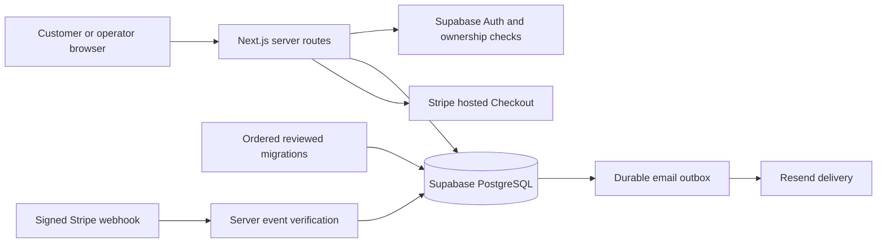

# G FORCE TYRES - Proposed canonical architecture

Date: 2026-10-10 (Asia/Dhaka). Status: **PROPOSAL ONLY - NOT IMPLEMENTED OR DEPLOYED**.

Audited application HEAD: `61346440dd64e5dacff31d6e6409236d08d3e6c8`.
Evidence and release limitations: [00_RECOVERY_AUDIT.md](00_RECOVERY_AUDIT.md).

## Plain-English decision

Use one shared Supabase database to establish which tyres exist, what they cost, which fitting appointments are available and what customers have actually paid. Ordered migrations are the versioned instructions for that database. An unavailable database must produce an honest unavailable response; a sample catalogue or a successful screen update cannot replace a saved booking.

The canonical foundation is **`supabase/migrations/001-012` plus future reviewed forward migrations**. Keep products separate from stock, bookings separate from provider receipts, and genuine business records separate from test fixtures. The legacy `schema.sql`, seeds and browser/process memory have no authority over production truth. This decision does not certify that the live database already matches the foundation.

## Runtime and trust boundaries

Retain Next.js 15 App Router, React 19, TypeScript, existing UI, Supabase PostgreSQL/Auth, Stripe, Resend, vehicle lookup and postcode validation. The recorded deployment uses Vercel; Cloudflare artifacts are an unverified alternate build path. Hosting changes are outside recovery scope.

A transaction is a group of database changes that all succeed or all fail. A row lock makes simultaneous requests wait for the same stock/slot record. RPC means a server call to a database function; the critical reservation/confirmation functions must run one transaction, not a sequence of independent HTTP writes. RLS (Row Level Security) restricts which rows a database user may access. The service-role key bypasses RLS, so every server endpoint must also enforce its own authorization and safe response fields.

Generate database types from the migration-verified schema and use explicit mappings to public/customer/admin response objects. A TypeScript `as` cast is not a field mapper. Browser state may hold an unfinished form and display estimate; it must never be accepted as stock, a reservation, receipt, role or saved booking.

## One final schema model

The following names are canonical. The first 19 tables already have declarations in `001-012`; the extension column distinguishes required recovery design from existing SQL. No SQL is created in this task.

| Table | Existing canonical fields/purpose | Proposed forward extension or required behavior |
| --- | --- | --- |
| `admin_profiles` | Auth `user_id`, `name`, `role` (`owner`/`admin`), `active` | Keep unique Auth linkage and recheck active status on every request. Provision/offboard with explicit actor and scope; never default a password or silently promote to owner. |
| `customers` | `first_name`, `last_name`, `email`, `phone`, timestamps | Add nullable unique `auth_user_id` referencing Auth and optional address fields needed by the existing account flow. Normalize email and resolve duplicates before introducing a case-insensitive unique email constraint. Guest rows retain null Auth linkage. Claim/link guest history only after verified mailbox ownership; never guess/split legacy names during migration. |
| `service_zones` | `name`, unique `postcode_prefix`, `callout_fee_pence`, `active`, `priority` | Resolve longest approved prefix, then priority; no inferred coverage or fees. |
| `tyre_products` | Unique `sku`/`slug`, dimensions, ratings, `run_flat`, `extra_load`, `season`, `tier`, active flag | Descriptive catalogue only. Preserve canonical `mid` enum; any display label is presentation. Missing safety/specification facts require real source data, not API defaults. |
| `inventory` | Unique `tyre_product_id`, `stock_qty`, `reserved_qty`, `cost_price_pence`, `selling_price_pence` | Available quantity is `stock_qty - reserved_qty`. Lock before reservation/change; prevent reducing stock below commitments. Public APIs omit costs and supplier details. |
| `availability_rules` | Day, local start/end, duration, capacity, active flag | Only owner-approved schedules generate slots; public GET never creates availability. |
| `booking_slots` | `date`, `start_at`, `end_at`, `capacity`, `active`, `blocked_reason`; unique triple | Interpret local times in `Europe/London`, including DST; lifecycle timestamps remain UTC `timestamptz`. Never reduce capacity below active commitments. |
| `blocked_dates` | Unique `date`, reason, Auth `created_by` | Durable block/unblock operation with actor/reason and audit. Existing bookings need an explicit resolution; blocking is not automatic cancellation. |
| `slot_holds` | `slot_id`, unique opaque `token`, `expires_at` | Server creates unguessable tokens; expire/release only the caller's hold. Lock slot and validate active/blocked/horizon/capacity. Consume hold into pending booking without counting both. |
| `inventory_holds` | Slot-hold/product links, quantity, expiry; unique pair | Reserve aggregate quantities for all cart lines in the same transaction as the slot hold. Expiry releases counters once. |
| `bookings` | Unique `reference`, UUID `manage_token`, customer/slot/fitter/zone links, `registration`, address, `postcode`, nine existing statuses and `_pence` totals | Add checkout idempotency and pending-payment expiry fields plus management-token expiry/revocation. Generate references with database uniqueness/retry. A reference is never an access credential. Do not store provider payment truth here. |
| `booking_items` | Product link, `sku_snapshot`, `brand_snapshot`, `model_snapshot`, `size_snapshot`, quantity, `unit_price_pence`, `line_total_pence` | Immutable purchase snapshots; totals and required fields validated transactionally. Product/price edits do not rewrite history. |
| `payments` | Booking link, provider, Checkout Session/PaymentIntent IDs, deposit/balance/refund type, status, `amount_pence`, currency | Add unique provider refund reference, parent-payment link, receipt/attempt timestamps and durable creation idempotency. Incoming-payment uniqueness and refund-parent linkage must allow multiple partial refunds without reusing an incoming-payment unique key. |
| `webhook_events` | Unique `(provider,event_id)`, event type and `processed_at` | Add processing outcome/error/retry timestamps and safe identifiers needed for reconciliation. Mark processed only when the business transaction commits. Deduplicate event identity and enforce business transition idempotency across different events. |
| `fitters` | Name, phone, van name, active flag | Authoritative assignments use database IDs; no demo fitter substitutions. |
| `business_settings` | Single row, `deposit_mode`, `deposit_value`, hold duration, horizon, same-day settings, contact/VAT/cancellation fields | Add explicit nonnegative `fitting_fee_pence` and durable cancellation wording needed by the existing journey. Fixed deposit uses pence; percent uses a validated integer percentage from 0 to 100. Defaults are structural starting values, not owner approval. |
| `audit_logs` | Auth actor, action, resource type/ID, metadata, time | Use for all privileged mutations, with reliable system attribution where appropriate. Critical mutation plus audit must commit together; exclude credentials and unnecessary personal data. |
| `vrm_cache` | Unique `lookup_hash`, encrypted bytes, `expires_at` | Keyed lookup hash and encrypted provider payload; bounded retention. Require provider-approved cache policy and valid encryption configuration before enabling. Never label invented fitment as provider data. |
| `interest_registrations` | Email, postcode, source, timestamp | Preserve consent/provenance and use explicit retention; no fabricated leads. |
| `booking_inventory_reservations` **NEW** | Proposed unique booking/product commitment, quantity and lifecycle state | Transfer checkout stock holds here atomically when a pending booking consumes its slot hold. Gives persisted ownership of reserved stock after hold deletion; fulfilled/released states make repeated events harmless. |
| `email_outbox` **NEW** | Proposed booking/event link, unique message purpose/key, template version, status, attempts, retry time, provider message ID and error summary | Persist required messages with the booking transaction; retry independently. A provider failure cannot undo a paid booking or be reported as delivered. |
| `rate_limits` **NEW** | Proposed bucket/window/counter/expiry with unique bucket/window key | Database-atomic increment/limit result. Define approved thresholds and behavior on outage; current read-then-update/fail-open helper is not sufficient. |

These extensions reconcile existing journeys and operational integrity; they do not authorize additional product features or implementation. Actual business values, records, names, prices, stock, fitters and schedules must be supplied/approved by the owner. Schema defaults, the old seed script and apparent demo demand are not evidence.

## Explicit field reconciliation

| Legacy name/input | Final canonical persistence |
| --- | --- |
| `tyre_inventory` | Descriptive row in `tyre_products`; stock/prices in `inventory` keyed by `tyre_product_id` |
| `stock`, `cost_price`, `sell_price` | `stock_qty`, `cost_price_pence`, `selling_price_pence` |
| `is_run_flat`, `is_xl`, `wet_grip`, `fuel_economy` | `run_flat`, `extra_load`, `wet_grip_rating`, `fuel_efficiency_rating` |
| `slot_date`, `start_time`, `end_time`, `max_bookings` on slots | `date`, `start_at`, `end_at`, `capacity` (`availability_rules` keeps its own `start_time`/`end_time`) |
| `session_token` on a hold | `slot_holds.token` or a server-managed lookup for that token; no browser assertion of validity |
| `booking_ref`, `vehicle_reg`, `fitting_postcode` | `reference`, `registration`, `postcode` |
| `tyres_total`, `fitting_fee`, `callout_charge` | `subtotal_pence`, `fitting_fee_pence`, `callout_fee_pence` |
| `total_amount`, `deposit_amount`, `balance_due` | `total_pence`, `deposit_pence`, `balance_pence` |
| Item `tyre_id`, `tyre_label`, `unit_price`, `line_total` | `tyre_product_id`, explicit immutable snapshots, `unit_price_pence`, `line_total_pence` |
| Zone `zone_name`, `callout_charge` | `name`, `callout_fee_pence` |
| `app_settings.deposit_fixed` / `deposit_percent` | `business_settings.deposit_value`, interpreted by `deposit_mode` |
| Booking-embedded Stripe IDs/paid timestamp | `payments` provider receipts and timestamps; customer paid state derived from successful receipts |
| `audit_log` | `audit_logs` with verified Auth/system actor and canonical resource fields |
| Customer `name` | Explicit real `first_name`/`last_name`; preserve the original legacy name during reviewed conversion and resolve ambiguous names with the owner |

Do not introduce permanently competing writable legacy tables/views. Temporary conversion tooling must preserve original IDs/relationships and have a reconciliation report. If the live ledger or data is inconsistent, stop before writing a migration rather than guessing its history.

## Booking and stock invariants

1. Server recalculates all amounts from approved active product/inventory/zone/settings records. Money is integer pence in GBP; aggregate duplicate product IDs before checking quantity/stock. Enforce item totals, booking total and nonnegative deposit/balance equations.
2. One transaction locks the slot and inventory rows in stable product-ID order, validates business rules and creates the slot/inventory holds. No unlocked fallback, demo success or availability-only bypass is permitted.
3. One idempotent transaction validates the unexpired owned hold, writes customer/pending booking/immutable items, transfers inventory holds to booking reservations and consumes the slot hold. The pending booking now occupies slot capacity by itself. A retry returns the same booking rather than reserving twice.
4. Proposed stock convention: `stock_qty` is unconsumed on-hand stock; `reserved_qty` includes unexpired checkout holds and live pending/confirmed booking reservations. Payment confirmation retains the reservation. Completion consumes stock and releases the reservation together. Cancellation/expiry releases a reservation once. A refund alone does not prove physical stock returned and must not automatically add stock.
5. This stock convention changes legacy payment-time stock deduction. The owner must validate it against the actual operation and existing records before implementation; never backfill consumed/reserved quantities from a payment status alone.
6. Configured checkout expiry, release and failure reconcile pending bookings, slot usage and stock reservations transactionally. A late payment after resource expiry enters a persisted reconciliation state for operator action; it cannot silently overbook or be forgotten after acknowledgment.

Keep the existing nine booking statuses initially. Paid/unpaid/refund truth comes from payment records, not a status string such as `confirmed`. Guard allowed transitions, permissions and resource effects in the server/database; casting arbitrary input to `BookingStatus` is not validation.

## One payment and email path

Use **Stripe hosted Checkout**, consistent with the normalized payment table and documented target. The browser receives a real checkout URL for a persisted pending booking. Remove production reliance on the custom mock card form, `demo_secret_*` and synthetic provider IDs in a future implementation.

- Persist a payment attempt before calling Stripe. Use a stable Stripe idempotency key tied to that attempt and real database booking ID in metadata. Stripe is an external system and cannot join a PostgreSQL transaction: reconcile provider creation success if the later database update fails.
- Only verified provider events may mark Stripe receipts succeeded. Verify expected booking/attempt, provider identity, paid status, amount, currency and session/intent association. Handle Checkout and related payment events through one idempotent state transition; redirects provide navigation only.
- Claim the unique event, update payment/resource/booking state and enqueue email in one transaction. Return retryable failure when persistence fails. An unrelated duplicate event must not repeat stock changes, release another customer's hold or resend a message.
- Refund records reference the original successful payment and a real unique Stripe refund ID. Reconcile cumulative partial/full refunds. Refund state, cancellation, stock return and fitting completion are separate facts.
- Assisted/phone bookings use the same reservation/pricing rules and remain unpaid until genuine payment evidence exists. No manual receipt method is introduced by this proposal; any later manual-payment policy requires explicit owner approval and cannot impersonate Stripe.
- A retry worker processes `email_outbox`, records provider results and retries transient failure. Configure a verified sender and actual public URL. Missing delivery configuration is visible to operations; no fictitious delivery status.

## Access and API rules

Anonymous catalogue responses contain only approved active product details, public price and a safe availability representation. They omit cost, supplier data and internal settings. RLS restricts direct clients; explicit server response projections must provide the same boundary.

Customer history is authorized by a verified Auth-user/customer link. Mailbox verification is required before linking an existing guest's records; auto-confirming arbitrary email input does not prove ownership. Queries must enforce customer identity even with the service role. Confirmations require that authenticated ownership or a valid management capability; short references alone grant no access.

Management capabilities are unguessable, expiring/revocable and scoped to one booking. Responses omit internal notes and irrelevant personal/provider fields. Protect secrets from logs, referrers and caches. Cancellation uses persisted policy, allowed states and transactional reconciliation.

Every admin endpoint independently validates the active profile, payload and permission, uses canonical records, checks the database result and writes an attributable audit. Blocking a date, changing capacity, assigning a fitter and editing stock are persistent operations. Client optimistic updates must roll back/show errors on failed persistence. No default credentials, automatic role escalation or browser-local writes can represent staff success.

## Forward migration delivery proposal

The three named files do not currently exist. Names below are proposed delivery slots, **not recovered files or proof of a deployed ledger**. Verify they are unused in the actual ledger before assigning them; resolve any version/checksum collision explicitly. Preserve all existing useful migrations.

| Proposed file | Recovery responsibility | Required accompanying code/evidence |
| --- | --- | --- |
| `013_gate2_booking_engine.sql` | Customer/pricing/linkage constraints and expiry/idempotency fields; booking inventory reservations; rate limiter; transactional hold/create/release/expiry functions against canonical names | Canonical types/mappers, real coverage/catalogue/pricing, no fallback writes; migration replay and upgrade; stock/slot concurrency and rollback tests |
| `014_gate3_stripe_webhook_email.sql` | Durable payment-attempt/refund model, webhook processing lifecycle and email outbox; atomic confirmation/reconciliation operations | Hosted Checkout route/UI, signed event processing, retry/reconciliation worker, genuine receipt mapping; duplicate/out-of-order/partial refund and email-outage tests |
| `015_gate4_admin.sql` | Remaining privileges/RLS, guarded administrative operations/audit integrity and safe ownership/token access changes | Repair existing admin/customer endpoints and screens; authorization, two-customer isolation, persisted mutations, token and audit tests |

Function names/signatures must be reviewed with callers and restricted to the intended server role. Merely copying legacy RPC names into a new migration does not reconcile their data contracts or accounting semantics. Update migration checks and verification expectations to match reviewed forward migrations.

## Validation and release boundary

First obtain a schema/ledger comparison for the real project without mutation. Then test migration replay and a sanitized upgrade locally or on a separately authorized disposable project. Preserve real IDs, snapshots and payment references; reconcile counts/totals and orphaned records. Test restart/multiple-instance behavior, genuine empty/error states, capacity-one and last-stock contention, safe expiry, receipts/webhooks/refunds, durable email, admin access and customer isolation.

Engineering complexity is **high** because changing the persistence contract under existing bookings/payments can lose or misstate financial records. A reliable time/cost estimate requires the live schema, data volume, migration history and provider state; none are verified here. The cheapest safe next step is the read-only hosted evidence pack, not rebuilding the product or importing sample data.

The developer's first deliverable should be a written comparison of the actual database and ordered migration contract, with an ID-preserving upgrade/reconciliation plan and test evidence. Production mutation, credential changes, deployment and financial transactions remain separate approval steps. This document authorizes none of them.
